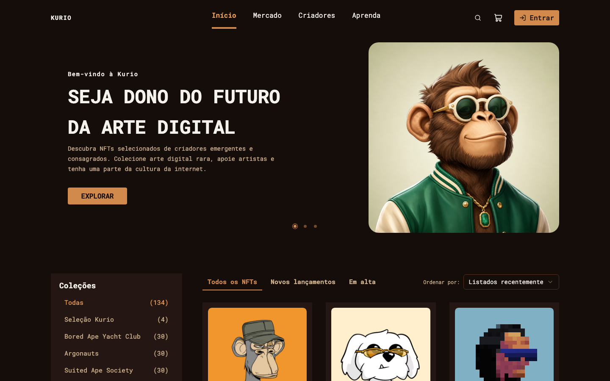
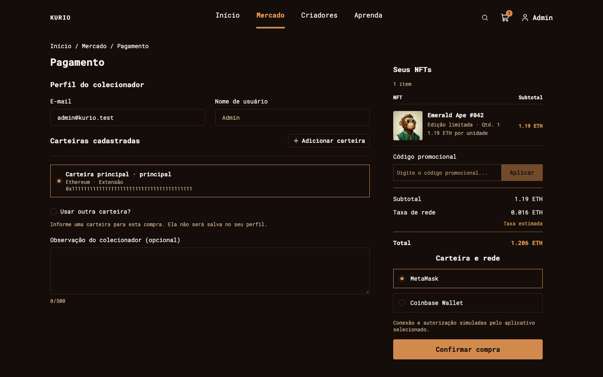

<h1 align="center"></h1>

<p align="center">
  Explore coleções de NFTs, salve favoritos e simule uma compra, do catálogo ao recibo.
</p>

<p align="center">
  
</p>

<p align="center">
  
</p>

Projeto desenvolvido para um desafio frontend com React e TypeScript. O layout segue o Figma e as regras estão no escopo. APIs, autenticação, pagamentos e carteiras são simulados com MSW. Não há transações reais de blockchain.

## Instalar e rodar

### Requisitos

- Node.js 24
- pnpm 11

### Instalação

```sh
pnpm install --frozen-lockfile
pnpm dev
```

Abra http://localhost:3000. Os mocks já estão habilitados em desenvolvimento.

Entre com `admin@kurio.test` ou `test@kurio.test`. Senha fictícia: `Kurio123!`.

## Comandos principais

| Comando                 | O que faz                                      |
| ----------------------- | ---------------------------------------------- |
| `pnpm dev`              | Inicia o ambiente local com mocks.             |
| `pnpm build:demo`       | Gera a demonstração com mocks.                 |
| `pnpm preview`          | Serve o último build gerado.                   |
| `pnpm build`            | Gera produção, sem mocks por padrão.           |
| `pnpm typecheck`        | Verifica os tipos TypeScript.                  |
| `pnpm lint`             | Verifica o código com Oxlint.                  |
| `pnpm format`           | Aplica a formatação com Oxfmt.                 |
| `pnpm format:check`     | Confere a formatação.                          |
| `pnpm test:e2e`         | Executa os testes Playwright.                  |
| `pnpm audit:lighthouse` | Gera as auditorias de qualidade e performance. |

## Configuração

Use `.env.local` para desenvolvimento ou `.env.demo.local` para demonstração. Reinicie o servidor após alterar as variáveis.

| Variável             | Uso                                    | Padrão                              |
| -------------------- | -------------------------------------- | ----------------------------------- |
| `VITE_MOCKS_ENABLED` | Ativa a simulação quando vale `true`.  | `true` nos modos development e demo |
| `VITE_MOCK_SCENARIO` | Seleciona o cenário inicial.           | `success`                           |
| `VITE_API_URL`       | Endereço da API REST.                  | `/api`                              |
| `VITE_SOCKET_URL`    | Servidor Socket.IO externo compatível. | Mesma origem                        |

As variáveis `VITE_*` ficam públicas. Não inclua segredos ou credenciais OpenSea.

## Publicação

Acesse a demonstração em [kurio-joaolucenalima.vercel.app](https://kurio-joaolucenalima.vercel.app).

A configuração da Vercel usa `pnpm build:demo`, publica `dist` e permite refresh das rotas. A hospedagem precisa de HTTPS para os mocks. O commit publicado ainda precisa ser registrado aqui na entrega.

## Documentação e referências

- [Escopo do desafio](docs/SCOPE.md)
- [Figma](https://www.figma.com/design/c2OlP8DR2m76iAMKyBhUmL/Frontend-Challenge--Copy-?node-id=0-1)
- [Arquitetura e decisões](docs/ARCHITECTURE.md)
- [Contratos REST](docs/API.md)
- [Cenários para testar manualmente](docs/MOCKS.md)
- [Tempo real](docs/REALTIME.md)
- [Testes e cobertura](docs/TESTING.md)
- [Tokens e decisões visuais](docs/design-tokens.md)
- [Dados e assets](docs/DATA.md)
- [Auditorias Lighthouse](docs/PERFORMANCE.md)
